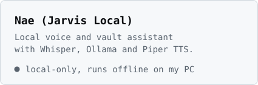

<picture>
  <source media="(prefers-color-scheme: dark)" srcset="./img/header-dark.svg" />
  
</picture>

<picture>
  <source media="(prefers-color-scheme: dark)" srcset="./img/neofetch-dark.svg" />
  
</picture>

<picture>
  <source media="(prefers-color-scheme: dark)" srcset="./img/linienplan-dark.svg" />
  
</picture>

<picture>
  <source media="(prefers-color-scheme: dark)" srcset="./img/projects-header-dark.svg" />
  
</picture>

<!-- One line per linked card: GitHub underlines links, so any whitespace inside <a> shows up as a stray underline. -->

<a href="https://createtim.de"><picture><source media="(prefers-color-scheme: dark)" srcset="./img/project-createtim-dark.svg" /></picture></a>
<a href="https://createtim.de/en/notebook-bread-roll-forecast.html"><picture><source media="(prefers-color-scheme: dark)" srcset="./img/project-forecast-dark.svg" /></picture></a>
<a href="https://timlietzow03.github.io/helium-start/"><picture><source media="(prefers-color-scheme: dark)" srcset="./img/project-helium-start-dark.svg" /></picture></a>
<a href="https://github.com/timlietzow03"><picture><source media="(prefers-color-scheme: dark)" srcset="./img/project-nae-dark.svg" /></picture></a>

<picture>
  <source media="(prefers-color-scheme: dark)" srcset="./img/projects-caption-dark.svg" />
  
</picture>

<picture>
  <source media="(prefers-color-scheme: dark)" srcset="./img/neural-dark.svg" />
  
</picture>

<picture>
  <source media="(prefers-color-scheme: dark)" srcset="./img/diagram-dark.svg" />
  
</picture>

